<p align="center">
  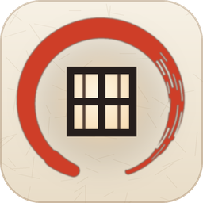
</p>

# Shoji 障子

*Your second screen, panel by panel.*

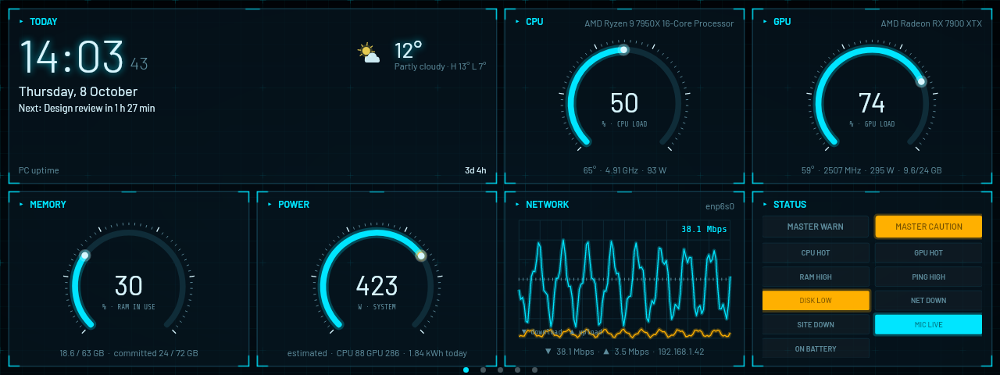

Shoji are the Japanese sliding screens made of paper panels in a wooden frame. This Shoji is a dashboard and touch
control panel for a small secondary screen on Windows 10/11. It starts with Windows, puts itself on the small monitor
full-screen, and shows live PC information in modular tiles, on as many pages as you like. **Scenes** switch pages by
themselves (game → gaming stats, Spotify → lyrics, away → big clock), and a **control deck** turns the screen into a
Stream Deck-style button panel.

Everything is optional and configurable in **Settings** (tray icon → Settings, or double-click the tray icon).

**Also on Linux** (Ubuntu and other desktops): see [Linux](#linux-ubuntu).

> **Formerly WinDisplay.** The first time Shoji starts, it takes over everything from WinDisplay: settings, pages,
> deck buttons, history, Start with Windows (including the admin task) and the install, then removes the old
> shortcut, Settings → Apps entry and files. Close WinDisplay first if it's an old version (1.2 or earlier).

## Download

Get the latest version from the [Releases page](https://github.com/Taheri-meisam/Shoji/releases/latest):

| System | Download | Then |
|--------|----------|------|
| Windows 10/11 | [`Shoji-Setup.exe`](https://github.com/Taheri-meisam/Shoji/releases/latest/download/Shoji-Setup.exe) | Run it and choose **Install** (no admin needed) |
| Windows, no install | [`Shoji-portable.zip`](https://github.com/Taheri-meisam/Shoji/releases/latest/download/Shoji-portable.zip) | Unzip anywhere and run `Shoji.exe` |
| Ubuntu / Debian | `shoji_<version>_amd64.deb` from the [Releases page](https://github.com/Taheri-meisam/Shoji/releases/latest) | `sudo apt install ./shoji_*_amd64.deb` |
| Other Linux | [`Shoji-linux-x64.tar.gz`](https://github.com/Taheri-meisam/Shoji/releases/latest/download/Shoji-linux-x64.tar.gz) | Unpack and run `./install.sh` |

Windows may say *"Windows protected your PC"* the first time because the exe isn't code-signed: click
**More info → Run anyway**. Each release lists SHA-256 checksums in `SHA256SUMS`. Details:
[Install or portable](#install-or-portable), [Linux](#linux-ubuntu).

## Screenshots

All pictures are 1280×480 (a common bar-shaped touch screen) with made-up demo data; the Windows and Linux apps look the same.

### Pages

Swipe between pages, or let scenes switch them for you (a game starts → Gaming).

**Main**: clock with weather, CPU, GPU, memory, power, network and the status lamps (Midnight)

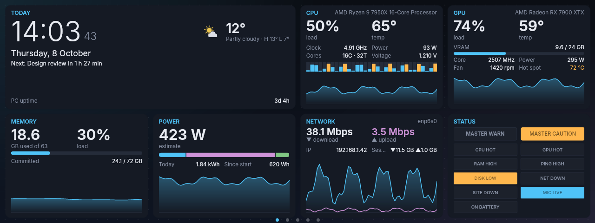

**Gaming**: FPS speedometer, CPU and GPU gauges, temperature tapes, ping, process radar, last session (Hypercar)

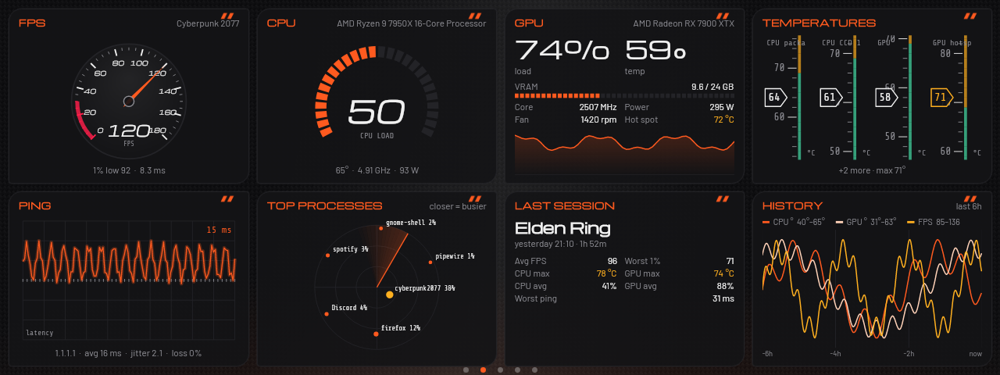

**Deck**: touch buttons, per-app volume, focus timer, fans, battery and drives (Aurora)

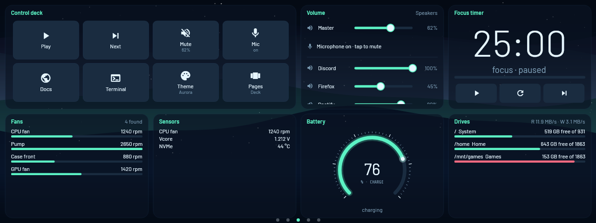

**Media and more**: now playing, notifications, web values, photo frame (Tokyo Neon)

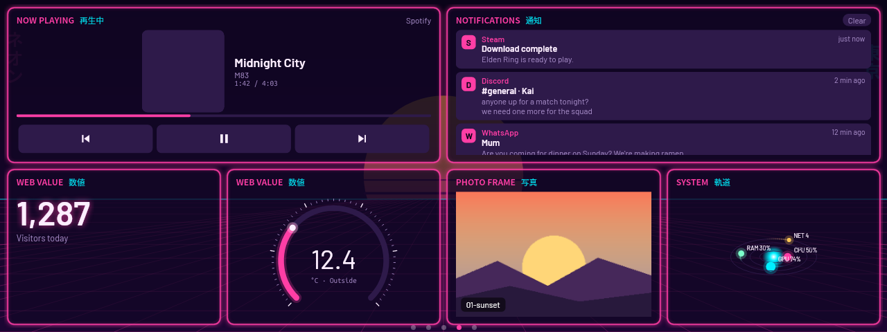

**Ambient**: big clock, weather, hourly forecast, calendar, agenda, world clock (Kanagawa)

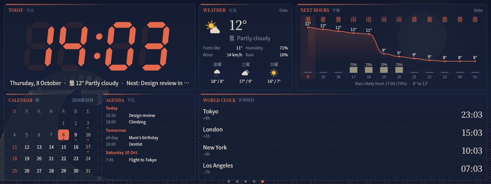

### Themes

16 of the 28 themes, all showing the same Main page:

<table>
<tr>
<td align="center"><br><b>Midnight</b></td>
<td align="center"><br><b>Futuristic</b></td>
</tr>
<tr>
<td align="center">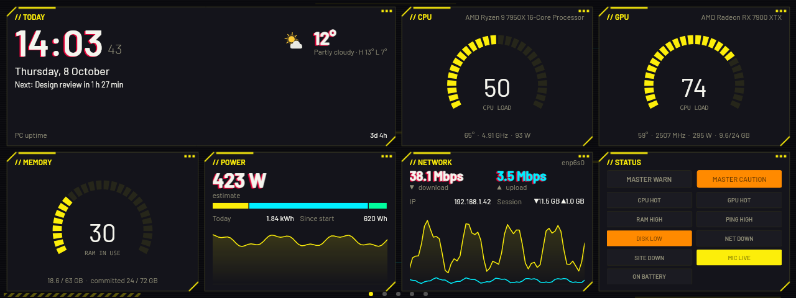<br><b>Cyberpunk</b></td>
<td align="center">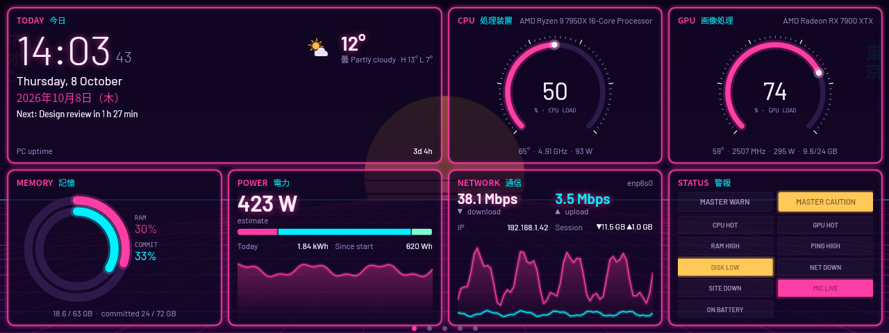<br><b>Tokyo Neon</b></td>
</tr>
<tr>
<td align="center">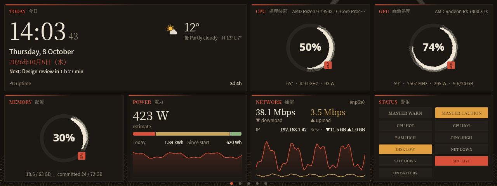<br><b>Sumi-e</b></td>
<td align="center">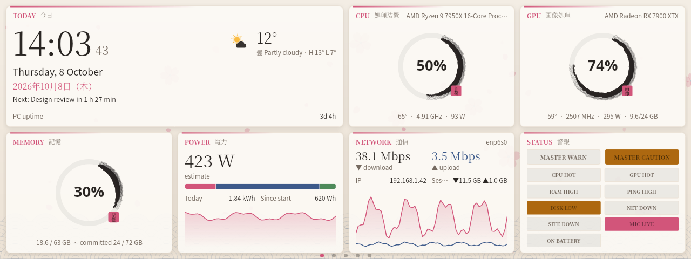<br><b>Sakura</b></td>
</tr>
<tr>
<td align="center">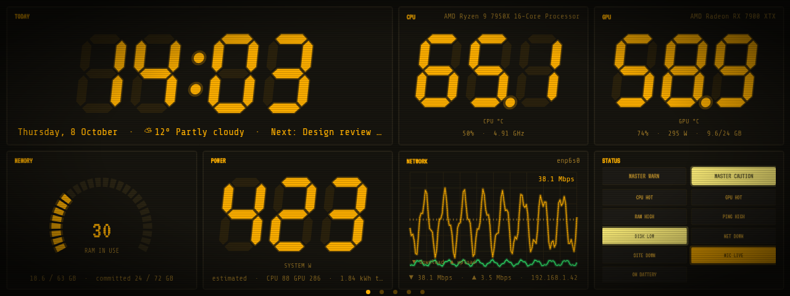<br><b>Cassette</b></td>
<td align="center">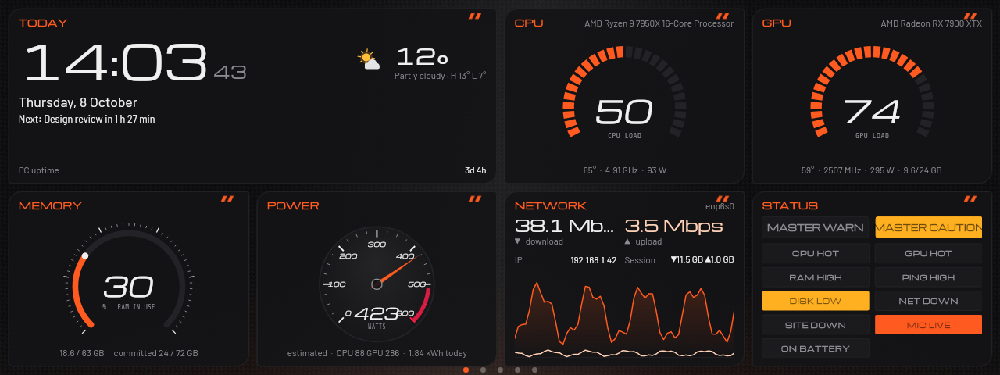<br><b>Hypercar</b></td>
</tr>
<tr>
<td align="center">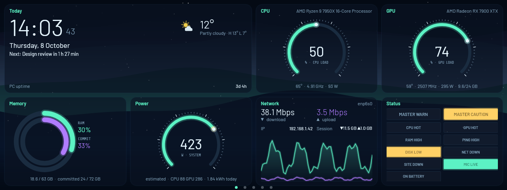<br><b>Aurora</b></td>
<td align="center">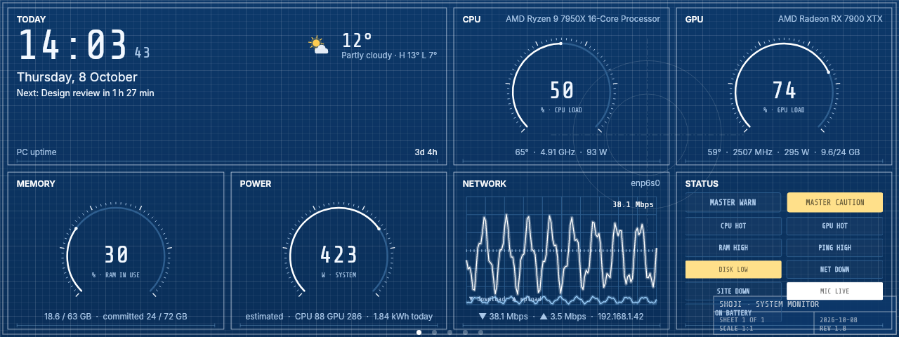<br><b>Blueprint</b></td>
</tr>
<tr>
<td align="center">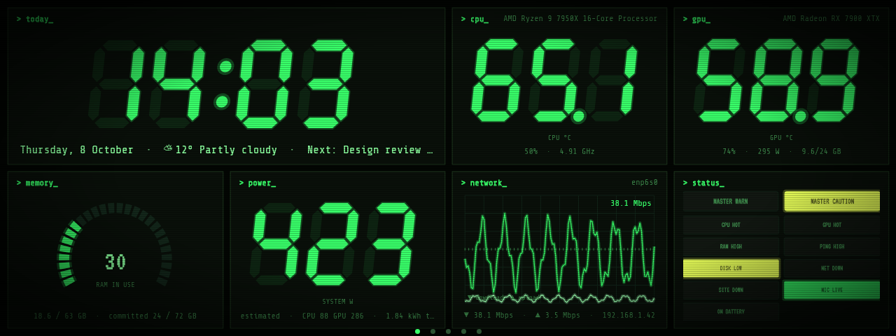<br><b>Terminal</b></td>
<td align="center">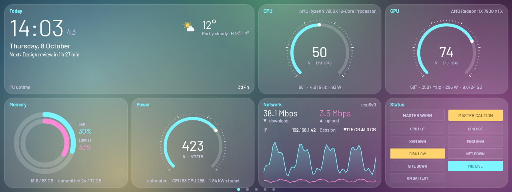<br><b>Glass</b></td>
</tr>
<tr>
<td align="center">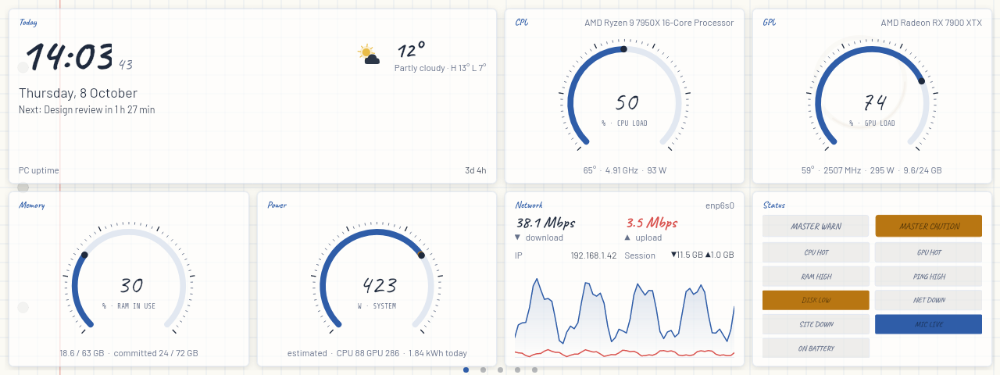<br><b>Notebook</b></td>
<td align="center">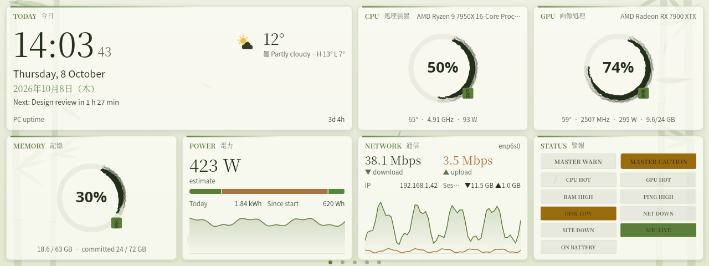<br><b>Matcha</b></td>
</tr>
<tr>
<td align="center">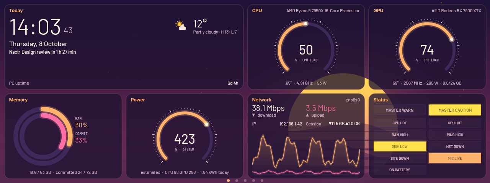<br><b>Lo-fi Sunset</b></td>
<td align="center">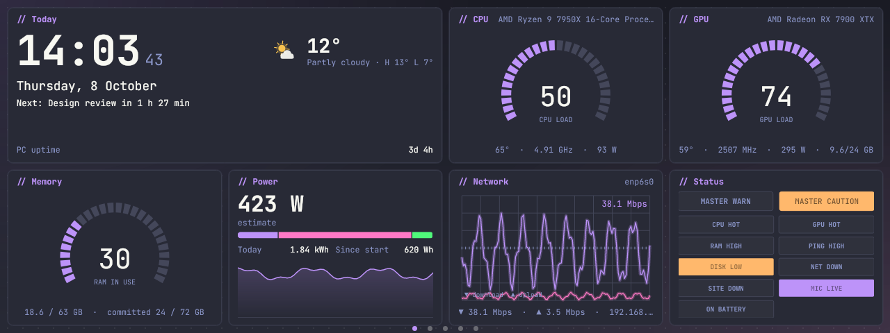<br><b>Dracula</b></td>
</tr>
</table>

## What's on the screen

### Tiles

| Module       | Shows |
|--------------|-------|
| `clock`      | Time, date, current weather (with today's high / low), PC uptime (Japanese themes add 2026年10月8日（木）) |
| `cpu`        | Load, temperature, clock, package power, cores/threads, voltage, per-thread load bars, history graph |
| `gpu`        | Load, temperature, hot spot, VRAM, core clock, fan, power, history graph (NVIDIA / AMD / Intel) |
| `memory`     | RAM used/total, load, committed memory, history graph |
| `network`    | Download/upload speed, IP, session totals, dual history graph |
| `ping`       | Latency, average, jitter and packet loss to a host (default 1.1.1.1), history graph |
| `disks`      | Free space per drive with usage bars, total read/write speed |
| `processes`  | Top processes by CPU (grouped by name, e.g. all Chrome processes together) |
| `temps`      | Every temperature, found automatically: CPU, CCDs, GPU core/hot spot/memory, each drive, motherboard, RAM |
| `fans`       | Every fan and pump that spins, found automatically (motherboard, GPU, USB coolers) |
| `system`     | Windows version and build, CPU, cores, GPU and driver, RAM kit and speed, motherboard, BIOS, screens |
| `weather`    | Current weather with an animated picture (turning sun, drifting clouds, falling rain or snow, lightning), feels-like, humidity, wind, rain chance, 3-day forecast ([Open-Meteo](https://open-meteo.com), no account) |
| `forecast`   | Next 6–24 hours: temperature curve, sky icon per hour, rain-chance bars, "rain likely from 17:00" |
| `calendar`   | This month with today highlighted, and dots under days with events (from your calendars) |
| `worldclock` | Time in other cities |
| `battery`    | Charge, charging / on battery, time left (laptops) |
| `activity`   | App in focus, how long it has been focused, today's per-app usage (idle time excluded) |
| `media`      | Now playing (Spotify, YouTube in a browser, etc.), album art, touch-friendly ◀ ⏯ ▶ buttons; "Large" option for a big cover |
| `lyrics`     | Synced lyrics of the song that's playing, karaoke style ([lrclib.net](https://lrclib.net), no account) |
| `power`      | Whole-PC power draw (measured CPU and GPU + estimate for the rest, or a smart PSU's own reading), breakdown, energy today and its cost |
| `fps`        | Frame rate, 1% low and frame time of the app in focus (DirectX 9–12; needs admin) |
| `recap`      | Your current / last game session: time played, average and worst FPS, peak temperatures, loads, worst ping |
| `history`    | Graphs of the last 1–24 hours: temperatures, loads, FPS, ping, network (kept across restarts) |
| `deck`       | Control deck: touch buttons that open apps / websites, press hotkeys, mute the mic, switch audio output, change power plan, take screenshots, run scripts, change page or theme… |
| `mixer`      | Master volume, microphone and per-app volume sliders; tap a name to mute, tap the device to switch output |
| `timer`      | Pomodoro focus timer with touch start / pause / skip |
| `agenda`     | Upcoming events from Google / Outlook / iCloud calendars (iCal link), coloured per calendar |
| `notifications` | Discord, WhatsApp, mail and other notifications, newest first; tap one to dismiss it. Kept in memory only, never saved or sent to the phone page |
| `webvalue`   | Any number or text from a web address or JSON API (a field like `current.temperature_2m` or `data.items[0].price`): big number with a graph, arc gauge or LED digits |
| `photos`     | Photo frame: your pictures one by one with a soft crossfade (default the Pictures folder); tap for the next |
| `mirror`     | Live copy of your main screen (with the mouse pointer), another window (Discord, OBS stats, a minimap…) or an area of the screen |
| `homeassistant` | Home Assistant lights / switches (tap to toggle), sensors and camera snapshots |
| `github`     | Latest CI run and open pull requests per repository |
| `twitch`     | Live Twitch chat of a channel (read-only, no login) |
| `ticker`     | Stock prices (Yahoo Finance) and crypto (CoinGecko) with today's change |
| `websites`   | Your sites: up/down light, response time and graph, HTTP status, 24 h uptime, days until the SSL certificate and the domain expire, optional "page must contain" check |
| `status`     | Caution / warning lamp panel driven by the alert limits |
| `overview`   | Whole PC as orbiting planets (or rings): CPU, GPU, RAM, network |
| `sensors`    | Any LibreHardwareMonitor sensor you choose by ID: voltages, pump, specific fans, … |

**Calendars**: add your iCal links once in Settings → Weather & time → Calendars (Test checks them). The Agenda tile
uses them, the Clock shows "Next: Standup in 12 min", and the Calendar marks days with events. Repeating events,
all-day events, time zones and cancelled events are handled; local `.ics` files work through `file://`.

**Album art**: while music plays, the cover appears blurred and dimmed behind a page with Now playing (best on
see-through themes such as Glass and Aurora). Switch it off in Settings → Appearance.

**Bedside picture frame**: make a page with one big Photo frame and a clock, then let night mode or a scene
(idle, or 22:00–07:00) switch to it.

## Power

Windows has no wall-power meter, so the Power tile adds up what is measured and estimates the rest, and always says which:

- **Measured**: GPU board power (no admin needed), CPU package power (needs the CPU-temperature fix: admin + PawnIO).
- **Estimated**: the rest of the PC (motherboard, RAM, drives, fans; 45 W by default) and PSU losses (90 % efficiency by default).
  Without the CPU driver, CPU power is estimated from load and marked with ≈.
- **Smart PSUs** that LibreHardwareMonitor can read (e.g. some Corsair and MSI models) replace the estimate with their
  own input-power reading: the tile then says "measured by …".

It keeps today's energy (kWh, survives restarts) and, with a price per kWh set, today's cost.

## What to put on the main page

A small second screen is glanced at, not read, so the main page works best with a few tiles that answer
"is anything wrong, and what's going on?" at a glance. The **Recommended** preset (Settings → Pages & tiles → Presets,
or tray → Tiles → Layout preset) sets this up:

| Tile | Why |
|------|-----|
| Clock (with weather), 2 wide | The thing you look at most; the weather comes free |
| CPU and GPU | Load and temperature: the first place to look when something feels slow or loud |
| Memory | Catches the "why is everything stuttering" moments |
| Power | What the PC draws right now and what today cost |
| Network | Download/upload, and whether you're online |
| Status board | Lights up only when something needs attention (hot, full, high ping, network down) |
| Now playing, 2 wide | Touch controls for music without leaving your game or work |

Everything else (FPS, temperatures, fans, forecast, deck, lyrics, mirror…) fits better on its own page, and scenes can
bring those pages up when they matter (a game starts → Gaming page).

## Any screen size

Shoji is built for every kind of second screen, from a 3.5" 480×320 panel to a 1920×480 bar or a 27" monitor:

- **Layout**: the column count is chosen from the screen's shape (a bar gets one or two wide rows, a portrait screen two columns).
- **Readable text, always**: text never shrinks below about 10.5 px. Instead, each tile adapts to its own size:
  *compact* tiles show just their main reading (the CPU tile drops its detail rows, thread bars and graph),
  *normal* tiles show the usual detail, *roomy* tiles show everything (e.g. the Power tile's breakdown list).
- **Too many tiles for the screen?** The extras move to a continuation screen ("Main (2)") that you swipe to,
  instead of everything becoming unreadable. Settings → Pages & tiles shows a preview of exactly what fits, the
  resulting text size, and a warning when tiles spill over.
- **Big screens** scale up (to 240 %) so they're filled, not sparse.
- The dashboard fills its screen completely: Windows 11 puts a taskbar on every screen, so Shoji hides the one on
  the dashboard's screen while it's there (never your main taskbar) and brings it back when it moves or quits.
  Turn it off in Settings → Appearance → Display → *Cover the taskbar*.
- Per-monitor display scaling (125 %, 150 %…) is handled; the Settings window fits laptops down to 1366×768.

## Pages

Tiles live on pages. **Swipe left / right** on the screen (or tap the dots at the bottom, or use a deck button / the tray)
to change page. A new install, and an upgrade from an older version, gets these pages; your old tiles stay on the first one:

| Page | Tiles |
|------|-------|
| Main | your tiles |
| Deck | control deck, volume mixer, focus timer |
| Gaming | FPS, CPU, GPU, temperatures, fans, ping, top processes, last session |
| Media | big now playing, lyrics |
| Ambient | big clock, weather, hourly forecast, system orbit, calendar, world clock |

Add, rename, reorder and delete pages in **Settings → Pages & tiles**. Each page can use a layout preset and its own
column count, and pages can rotate automatically. Tiles on hidden pages keep updating, so graphs are full when you swipe to them.

**Edit right on the screen**: hold a finger (or the mouse button) on any tile for about half a second. A sheet opens to
move it left or right, make it narrower or wider, change its style, send it to another page or hide it (with Undo).
**More settings…** opens Settings at that page. The press never also taps the button under your finger. Switch it off in
Settings → Pages & tiles → *Hold a tile to edit it on the dashboard*.

**Share a layout**: Settings → Pages & tiles → *Export layout…* saves a file, *Copy layout code* copies a short
`shoji1:…` code. *Import layout…* shows what's inside (pages, tiles, theme, deck buttons that launch programs), then
adds the pages or replaces yours. Tokens, keys, passwords and calendar links are never included.

## Scenes

A scene says "when *this* happens, show *that* page (and optionally use *that* theme)". Conditions: the app in focus
(process name, `*wildcards*` or a path part like `\steamapps\`), *app is full screen*, *except these apps*,
*away for N minutes*, and a time window. All conditions you fill in must match; the first matching scene wins.
When no scene matches, the dashboard returns to the page you were on (unless you swiped elsewhere meanwhile).
A scene has to hold for 1.5 s before it switches, and let go for 4 s before it switches back, so alt-tab doesn't flicker.

Built-in examples: **Gaming** (any full-screen app except browsers / video players → Gaming page),
**Away** (10 minutes idle → Ambient page), **Music** (Spotify in focus → Media page).
Edit them in **Settings → Scenes**, which also lists the apps you used recently so you know their process names.
Switch all scenes off from the tray (*Automatic scenes*) or a deck button.

## Control deck

**Settings → Control deck** edits the buttons: icon (a name like `mic`, `play`, `game`, `lock`, … or any emoji / text), label,
action and target. Examples are one click away. Actions:

| Action | Target |
|--------|--------|
| Open a program | `notepad.exe`, a game's exe, … (+ arguments) |
| Open a website / folder | `https://…`, `steam://rungameid/570`, `spotify:`, `shell:Downloads`, `C:\Folder` |
| Press keys | `Ctrl+Shift+M`, `Win+Shift+S`, `F13`, `MediaPlayPause`… sent to the app in focus |
| Media control | `playpause`, `next`, `previous` |
| Microphone / speaker mute | – (the button turns red while muted) |
| Volume | `+5`, `-5`, `40` |
| Switch audio output | empty = next device, or names like `Headphones\|Speakers` |
| Power plan | `balanced`, `high`, `saver`, or a plan name |
| Screenshot | empty = save the main screen to Pictures\Screenshots, `snip` = Snipping Tool |
| Run a command / PowerShell | runs hidden |
| Go to page / Change theme / Auto scenes on-off / Lock / Sleep | |

The dashboard never takes keyboard focus, so hotkeys reach the game or app you're using. A game that runs as admin
only receives keys if Shoji runs as admin too.

**OBS Studio**: the *OBS Studio* action records, pauses, streams, saves the replay buffer (`replay`), toggles the
replay buffer or virtual camera, switches scenes (`scene:Gaming`) and mutes inputs (`mute:Mic/Aux`). The buttons
show OBS's state like a Stream Deck: Record turns red with a running `REC 12:34`, Stream shows `LIVE`, the current
scene is lit and muted inputs turn red; they dim while OBS is closed. Setup: in OBS, Tools → WebSocket Server
Settings → Enable (OBS 28+); in Shoji, Settings → Control deck → OBS Studio, enter the password and press Test
connection. Shoji only talks to OBS while a deck has OBS buttons.

## Website monitoring

The **Websites** tile checks each site every minute (configurable): it loads the page like a browser would, times it,
reads the SSL certificate's expiry, looks up the domain's registration expiry twice a day, and (if you set it) makes
sure the page still contains a piece of text, which catches broken pages that still answer "200 OK".

One failed check turns the site amber and triggers a retry 15 seconds later; only two failures in a row mark it **down**,
so a hiccup doesn't raise an alarm. A site that's down raises the alert banner and lights **SITE DOWN** on the Status
board; a certificate expiring within 14 days (domain: 28 days) gives a warning. The phone dashboard lists your sites too.

## Alerts, day/night and animations

- **Alerts**: a banner flashes (with a sound) when the CPU or GPU gets too hot, memory or a drive is nearly full, ping
  spikes, or a website goes down or its certificate is about to expire, after it has lasted 5 seconds. Tap it to hide those alerts for 10 minutes. Thresholds in Settings → Alerts.
- **Day and night**: pick a day theme and a night theme with start times (Settings → Appearance).
- **Animations**: drifting petals (Sakura), a scan line (Futuristic), glitch slivers (Cyberpunk), neon flicker (Tokyo Neon),
  slow mist (Sumi-e, Modern). They also help against burn-in. Switch off in Settings → Appearance. On Linux they pause
  after 10 minutes without input and while the dashboard is minimized.
- **Status board**: caution lamps blink until you tap the tile; they stay lit while the problem lasts.
- **Language**: English or Norwegian (bokmål), Settings → Appearance → Language ("Automatic" follows Windows / your
  desktop). Dates use the language too ("torsdag 8. oktober"). Translations are `Lang/nb.json` files of
  `"English": "norsk"` pairs; missing entries stay English, so adding a language is one file.
- **Night mode** (Settings → Appearance): between two times the dashboard dims to the brightness you pick, or goes fully
  black at 0 % (as good as off, and kind to OLED panels). A tap brings it back to full brightness for a few seconds; that
  first tap never presses anything.
- **Saves power when nobody can see it**: animations, gauges and Mirror tiles pause while the display is off, the PC is
  locked (Windows; on Linux the GNOME/KDE lock screen) or night mode is black, and pick up again when it comes back.

## Phone / tablet dashboard

Settings → Phone dashboard → **Serve the web dashboard** shows a link and QR code (`http://<your PC>:8787/?key=…`). Open it on a
phone or tablet on the same network for a live, themed dashboard. It needs the secret key in the link and doesn't show
window titles. Windows Firewall asks once whether to allow it; allow it on private networks only.

Turn on **Let the phone press deck buttons** and your control-deck buttons appear on the phone page too, as big touch
buttons. Anyone with the link can press them, so keep it to your home network. Buttons that run commands or scripts are
never shown on the phone.

## Online tiles: what to fill in

| Tile | Settings |
|------|----------|
| Weather | Uses the place in **Settings → Weather & time**: start typing a city and pick it from the list (empty = Windows location). A tile can set its *Own city* in its Options |
| Hourly forecast | Same place as the Weather tile; *Hours* sets 6–24 (default 12) |
| Clock | Shows the weather next to the time (same place); tick *Hide the weather* to turn it off |
| World clock | Pick the cities from the time-zone list on the tile (Settings → Pages & tiles), with an optional name each |
| Agenda | Google Calendar: *Settings → your calendar → Secret address in iCal format*. Outlook: *Settings → Calendar → Shared calendars → Publish*. Several links: comma separated |
| Home Assistant | Server URL, a long-lived access token (*your profile → Security*), entities like `light.desk=Desk lamp, sensor.living_temperature, camera.door` |
| GitHub | `owner/repo` list; a token only for private repos or more frequent updates |
| Twitch | Channel name |
| Markets | Stock symbols (`AAPL, MSFT, ^GSPC`), CoinGecko coin ids (`bitcoin, ethereum`), currency |
| Mirror | **Choose what to mirror…** opens a picker: click a screen or an app window (with live thumbnails and app icons), **Crop…** a window by dragging over its snapshot, **click a window on screen**, or **draw an area** across your monitors. No typing needed. Protected video (Netflix etc.) and exclusive-fullscreen games show black; borderless games work |
| Websites | Add sites in the tile's editor: address (`example.com` is fine), optional name, optional text the page must contain. *Check every* sets the interval (default 60 s). Domain expiry comes from RDAP (the registry's public record) |
| Power | *Price per kWh* (and currency) to see what today cost; *Rest of PC* watts and *PSU efficiency* tune the estimate |

Tokens and calendar links are stored in `config.json` in your user profile; they are masked in Settings.


## Themes

Pick one in **tray → Theme** or in **Settings → Appearance**, where they're grouped (Everyday, Sci-fi & speed,
Japanese, Retro, Code) with a live preview of each. It switches instantly. 28 themes:

| Theme | Look | Default gauges |
|-------|------|----------------|
| **Midnight** | The original: calm dark blue, rounded tiles over a quiet dot grid | Classic |
| **Modern** | Graphite glass, soft colour glow in the background, light-weight numbers | Classic |
| **Futuristic** | Holographic HUD: corner brackets, grid backdrop, scan line, glowing cyan numbers | Arc gauges, flight tapes, oscilloscope |
| **Cyberpunk** | Night-city yellow on black, chamfered panels, scanlines, red "glitch" shadow on numbers | LED arcs, LED digits, process radar |
| **Tokyo Neon** | Neon-tube outlines that flicker, synthwave sun and grid, ネオン/東京 signs, kanji labels | Arc gauges, rings |
| **Sumi-e** | Japanese ink: charcoal, vermilion and gold, Mincho type, ensō circle and seigaiha waves | Ensō brush gauges |
| **Sakura** | Light theme: washi paper, drifting cherry-blossom petals, pink and indigo | Ensō brush gauges |
| **Mission Control** | Flight-director calm: navy consoles, condensed caps, caution lamps | Arc gauges, flight tapes, oscilloscopes |
| **Capsule** | Spacecraft-touchscreen minimalism: true black, white hairline gauges, big targets | Thin arc gauges |
| **Cassette** | Used-future 1979: amber phosphor CRT with scanlines and vignette | LED digits, oscilloscopes, LED clock |
| **Hypercar** | Electric supercar cluster: carbon weave, blade-cut panels, slanted numbers | Speedometer (FPS), shift-light LED arcs, coolant tubes |
| **Deep Space** | Nebula and stars behind glass tiles | System orbit, rings, process radar |
| **Aurora** | Northern lights that sway and breathe behind frosted tiles, green and violet | Arc gauges, rings, orbit |
| **Fjord** | Calm arctic palette: frost blue on slate, layered mountains, slow snowfall | Rings |
| **Blueprint** | Engineering drawing: blueprint paper, white line work, registration marks, a title block | Hairline arcs, flight tapes, oscilloscopes |
| **Kintsugi** | Black lacquer mended with gold seams, Mincho type, kanji labels | Ensō gauges |
| **Terminal** | Green-phosphor console: `> cpu_` prompt titles, LED digits, CRT scanlines | LED digits, oscilloscopes, radar |
| **Glass** | Frosted, see-through tiles over big colour fields that drift slowly | Arc gauges, rings |
| **Notebook** | Light theme: squared paper with a red margin and a coffee ring, blue ink, handwritten numbers (Caveat) | Arc gauges |
| **Deep Sea** | The abyss: light rays from far above, glowing plankton rising, a drifting jellyfish | Arc gauges, rings, orbit |
| **Kanagawa** | The great wave at night: indigo, a curling wave with foam, seigaiha scales, a pale moon, kanji labels | Arc gauges, ensō |
| **Matcha** | Light theme: green tea on washi paper, bamboo at the edges, leaves drifting down, Mincho type | Ensō brush gauges |
| **Lo-fi Sunset** | A striped retro sun sinking behind purple hills, dust in the light, warm peach and pink | Arc gauges, rings |
| **Catppuccin** | The Mocha editor palette: soothing pastels, JetBrains Mono numbers | Arc gauges, rings |
| **Dracula** | The famous dark editor palette, all JetBrains Mono, `// cpu` titles, dot-grid canvas | LED arcs, oscilloscope |
| **Gruvbox** | Retro groove: warm browns and mustard, monospace, `> cpu_` prompts | LED digits, oscilloscopes |
| **Tokyo Night** | The editor theme: soft blue and violet after rain | Arc gauges, rings, oscilloscope |
| **OLED Black** | Pure black with thin outlines, kindest to OLED panels | Classic |

Japanese themes also show the date in Japanese, weekday kanji in the calendar (Sunday red, Saturday blue)
and the weather's kanji (晴 曇 雨 雪 雷) next to the animated weather picture. The themes use fonts bundled with the app (Michroma, Orbitron, Barlow,
Share Tech Mono, VT323, JetBrains Mono, Caveat; SIL Open Font License, see `src/Shoji/Fonts`) plus fonts that ship with Windows. Themes live in
`src/Shoji/UI/Themes.cs`; adding one there puts it in every menu. The newer backdrop art (bamboo, ocean, sunset,
glass, paper, wave, dot grid) is drawn by `src/Shoji/UI/BackdropArt.cs`, one file shared by the Windows and Linux
apps, with a still layer behind the tiles and a 20 fps moving layer only while Animations is on.

## Gauge styles

Many tiles can be drawn in more than one way. Each tile has a **Style** setting (Settings → Pages & tiles); "Theme
default" lets the theme decide, so switching to Hypercar turns FPS into a speedometer and Cassette turns it into LED digits.
Needles and arcs ease toward new readings like real instruments, and warning zones follow your temperature and alert limits.

| Style | Looks like | Tiles |
|-------|-----------|-------|
| Arc gauge | Electric-car power meter: 270° arc turning amber/red, tick ring | CPU, GPU, memory, FPS, battery, focus timer |
| Speedometer | Dial with tapered needle, numbers and a red zone | FPS, CPU clock, GPU |
| LED arc | Race-car shift lights with peak hold | CPU, GPU, memory, battery |
| Rings | Concentric load rings | Memory, system |
| Flight tape | Airliner tape scale with colour zones and a 6-second trend line | FPS, temperatures |
| Coolant tubes | Liquid tubes with a moving surface | Temperatures |
| Hex threads | Every CPU thread as a honeycomb cell | CPU |
| Radar | Sweeping scope; busiest processes closest to the centre | Top processes |
| Oscilloscope | Phosphor trace on a graticule | Network, ping |
| LED digits | Seven-segment readout with unlit segments | CPU / GPU temperature, FPS, ping, clock, hottest sensor |
| Ensō | Ink brush circle that closes as load rises, with a seal | CPU, GPU, memory, focus timer |

Two tiles are new: **Status board** (caution and warning lamps with master buttons, lit by your alert limits:
CPU/GPU hot, RAM high, ping high, disk low, network down, mic live, on battery) and **System orbit** (CPU, GPU, RAM
and network as planets that orbit faster as they work harder, or as rings).

## Install or portable

Download one of these (or build them, below). They all contain the same program:

| File | What happens |
|------|--------------|
| `Shoji-Setup.exe` | The installer: shows **Install** (or **Update**), **Run portable**, **Just run this time** |
| `Shoji.exe` | Run it from Downloads or anywhere outside its install folder and it offers the same choices. Tick *Don't ask again for this copy* to run it loose without the question |
| `Shoji-portable.zip` | Unzip anywhere (a USB stick, a tools folder) and run; it never asks to install |

Already running a copy that isn't installed? **Tray icon → Install Shoji on this PC…** (also in Settings → About & install).
After installing, a notification confirms it and Shoji is in the Start menu.

**Installed** (recommended): the exe copies itself to `%LOCALAPPDATA%\Programs\Shoji` (just for you, no admin),
adds a Start menu shortcut and an entry in *Settings → Apps* with an uninstaller. Settings live in `%APPDATA%\Shoji`.
Start with Windows keeps working even after you delete the download.

**Portable**: everything stays in a `data` folder next to the exe; nothing is added to Windows unless you turn on
*Start with Windows* yourself. A file called `portable` next to the exe is what makes it portable; delete it to switch
back. If you move the folder, autostart is pointed at the new location the next time you start it.

- **Automatic updates**: Shoji checks [the GitHub releases](https://github.com/Taheri-meisam/Shoji/releases) every
  12 hours, tells you once per version, and installs only when you tap *Install*, after checking the download's SHA-256.
  Settings → About & install → *Check for updates* turns this off; *Update source* points it at another `owner/repo`
  or the link of a `latest.json` (for your own builds). Releasing: `scripts/build-deb.sh`, then
  `scripts/make-release.sh OWNER/REPO --notes notes.md --packages`, then run the `gh release create` command it prints.
- **winget / Scoop**: manifests are in `packaging/winget` and `packaging/scoop` (filled in by `make-release.sh --packages`).
  Silent install for scripts: `Shoji-Setup.exe --install --quiet`.
- **Update by hand**: run the newer `Shoji-Setup.exe` (or `Shoji.exe`) and choose *Update*. It closes the running copy, replaces the installed one
  and keeps all your settings. (Settings → About & install does the same from a newer copy.)
- **Switch later**: Settings → About & install → *Install on this PC* or *Make this copy portable*.
  Installing from a portable copy brings its settings along.
- **Uninstall**: *Settings → Apps → Shoji → Uninstall* (or Settings → About & install → Uninstall).
  It removes the app, the shortcut, Start with Windows (one admin prompt if the admin autostart task exists) and the
  firewall rule of the phone dashboard, and asks whether to delete your settings too. The PawnIO driver is a separate
  program and stays; remove it in Settings → Apps if nothing else uses it.
- Windows SmartScreen may warn about an "unknown publisher" the first time, because the exe isn't code-signed:
  *More info → Run anyway*.

## Build

You need the [.NET 10 SDK](https://dotnet.microsoft.com/download/dotnet/10.0) (Windows, or Linux/macOS for building only).

```powershell
powershell -ExecutionPolicy Bypass -File scripts\publish.ps1
```

This produces `dist\Shoji-Setup.exe`, `dist\Shoji.exe` (the same single file that needs nothing else installed)
and `dist\Shoji-portable.zip`.
(Use `-FrameworkDependent` for a smaller exe if the .NET 10 Desktop Runtime is already installed.)

For development, `dotnet run --project src\Shoji` also works (debug builds never show the install prompt).
The app icon (a vermilion ensō brush circle, open at the bottom like a gauge dial, around a backlit shoji window) is drawn
by `scripts/make_icon.py`; small sizes get a simpler, bolder drawing so the tray icon stays readable.

Command-line switches: `--install`, `--uninstall [--quiet]`, `--portable` (make this copy portable),
`--no-setup` (don't show the install prompt), `--autostart` (added by Start with Windows; never prompts),
`--restarted` (wait for the previous copy to exit).

Upgrading to 1.8 applies the **Recommended** layout to your first page once (tiles it doesn't use stay there, switched off).

## First run

1. Run `Shoji.exe` and pick *Install* (or unzip and run the portable version).
2. It opens full-screen on your **smallest non-main monitor**. With only one monitor it stays hidden
   (so it never covers your main screen) and waits for one to be connected.
3. Click the tray icon to open the menu (double-click opens Settings):
   - **Settings…**: Shoji's own look (warm washi paper in light mode, ink in dark mode, vermilion accent; pick
     Light, Dark or Auto at the bottom of the sidebar). Sections, each with its colour icon: Appearance, Pages & tiles
     (a colour-coded preview of how each page fits your screen, layout presets and an "Add a tile" gallery), Scenes,
     Control deck (with a preview of the buttons), Alerts, Phone dashboard (QR code), Hardware sensors (what works and
     what needs setup, which graphics card to show) and About & install (start with Windows). Also: **Weather & time**
     (a city picker that searches as you type, °C / °F, 24-hour clock), custom accent / background / tile colours,
     when temperatures turn orange and red, a world-clock city picker, History graph chips and a deck icon picker. A search box at the top finds a section by any word ("fan", "hotkey",
     "monitor"). On / off settings are switches, short choices are segmented buttons, and every change shows on the
     dashboard right away.
   - **Enable CPU temperature**: installs the PawnIO driver and restarts as admin (see below).
   - **Theme**: switch theme.
   - **Page**: jump to a page. **Automatic scenes**: switch scenes on / off.
   - **Tiles on "…"**: switch any tile on or off on the page that's showing, or apply a **layout preset** to it.
   - **Show on monitor**: pick a specific screen.
   - **Start with Windows** → **On** or **On, as admin**.
   - **Edit config.json**: everything, including options that have no button. Changes apply as soon as you save.
   - **Export sensor list**: lists every sensor ID, for the `sensors` module.

The window has no taskbar button, doesn't show up in Alt+Tab, and never takes keyboard focus,
so tapping the media buttons won't pull you out of a game.

## Admin rights and CPU temperatures

GPU sensors, CPU load and clock, memory, network and everything else work as a normal user. **CPU temperature,
CPU power/voltage and motherboard fans/temperatures** need two things:

1. The **PawnIO** driver, which LibreHardwareMonitor uses to read CPU registers (<https://pawnio.eu>).
2. Shoji running **as administrator**.

**Tray → Enable CPU temperature** does both: it installs PawnIO with `winget` (one UAC prompt, a window shows
progress), switches *Start with Windows* to the admin logon task if autostart was on, and restarts Shoji
elevated. The admin logon task starts it elevated **with no UAC prompt** at every logon. It waits 10 s after logon
so the second monitor has time to wake up, and runs on battery with no time limit.

Until then, the CPU tile says why the temperature is missing (`temp · needs PawnIO` or `temp · needs admin`)
instead of showing a wrong value. Without the driver LibreHardwareMonitor reports 0 °C, 0 W and 1.55 V rather than
failing, so Shoji ignores driver-based readings unless the driver can really be used. CPU name, load,
per-thread load, cores and clock come from Windows itself (the same counters Task Manager uses) and always work.

## Settings: `config.json`

In `%APPDATA%\Shoji` (installed) or the `data` folder next to the exe (portable).

```jsonc
{
  "Monitor": "auto",          // "auto" | "primary" | "1", "2"… (left→right) | "\\\\.\\DISPLAY2"
  "RefreshMs": 1000,          // refresh interval
  "Scale": 1.0,               // extra zoom on top of the automatic sizing
  "Columns": 0,               // 0 = automatic
  "Topmost": false,
  "PixelShift": true,         // moves the layout by a few pixels every 3 minutes to prevent OLED burn-in
  "Use24HourClock": true,
  "Theme": "hypercar",        // midnight modern futuristic cyberpunk tokyo sumi sakura mission capsule cassette hypercar space oled
  "Animations": true,
  "SettingsLook": "auto",       // the Settings window: auto (like Windows), light or dark
  "City": "Tokyo, Japan|35.6895,139.6917", // weather place: picked in Settings (name|lat,lon), or just "Tokyo"; null = Windows location
  "PageCycleSeconds": 0,      // rotate pages every N seconds (0 = off)
  "ScenesEnabled": true,
  "TemperatureUnit": "C",     // "C" or "F"
  "AccentColor": "#FF3EA5",   // optional overrides on top of the theme; leave out to use the theme's colours
  "BackgroundColor": null,
  "TileColor": null,
  "TempWarn": 70,             // °C, value turns orange
  "TempCrit": 85,             // °C, value turns red
  "GpuIndex": 0,              // which GPU if you have several (discrete ones first)
  "Pages": [
    { "Name": "Main", "Columns": 0, "Modules": [
      { "Type": "clock", "Span": 2 },           // span 2 columns (9 = always full width)
      { "Type": "cpu", "Options": { "Style": "speedometer" } },  // classic, arc, led, speedometer, segments, enso, hex
      { "Type": "memory", "Enabled": false },   // hide a tile
      { "Type": "network", "Title": "Internet" }, // rename a tile
      { "Type": "weather", "City": "Tokyo" },
      { "Type": "ping", "Host": "8.8.8.8" },
      { "Type": "worldclock", "Zones": [
          { "Zone": "Tokyo Standard Time", "Label": "Tokyo" },  // Windows or IANA ids ("Asia/Tokyo")
          { "Zone": "America/New_York", "Label": "New York" }
      ] },
      { "Type": "history", "Span": 2, "Options": { "Series": "cpu.temp, gpu.temp, fps", "Hours": "6" } },
      { "Type": "sensors", "Title": "Cooling", "Sensors": [
          { "Id": "/lpc/nct6798d/fan/1", "Label": "CPU fan" },
          { "Id": "/nvme/0/temperature/0", "Label": "NVMe" }
      ] }
    ] },
    { "Name": "Deck", "Modules": [
      { "Type": "deck", "Span": 9, "Options": { "Columns": "5" }, "Buttons": [
          { "Icon": "mic", "Label": "Mic", "Action": "mic" },
          { "Icon": "game", "Label": "Steam", "Action": "url", "Target": "steam://open/main" },
          { "Icon": "keyboard", "Label": "Discord mute", "Action": "keys", "Target": "Ctrl+Shift+M" }
      ] }
    ] }
  ],
  "Scenes": [
    { "Name": "Gaming", "Fullscreen": true, "ExceptApps": [ "chrome", "msedge", "vlc" ], "Page": "Gaming", "Theme": "cyberpunk" },
    { "Name": "Music", "Apps": [ "spotify" ], "Page": "Media" },
    { "Name": "Night", "From": "23:00", "To": "06:00", "Theme": "oled" }
  ],
  "DayNight": { "Enabled": false, "DayTheme": "sakura", "NightTheme": "sumi", "DayStarts": "07:00", "NightStarts": "19:30" },
  "Alerts": { "Enabled": true, "CpuTemp": 90, "GpuTemp": 85, "RamPercent": 95, "DiskFreePercent": 5, "PingMs": 200, "Sound": true },
  "Web": { "Enabled": false, "Port": 8787 }
}
```

Tiles appear in the order listed, filling rows left to right. If a row isn't full, its last tile
stretches to the edge, so there are no empty gaps. Comments and trailing commas are allowed in the file
(but Settings and the tray menu rewrite it without comments). If the file can't be read, the app starts
with defaults and keeps a copy of your file as `config.invalid.json`.
Sensor IDs depend on your hardware; get the real ones from tray → **Export sensor list**.

Other files in the same folder: `activity.json` (today's app usage), `history.json` (24 h of graphs), `recap.json`
(last game session), `log.txt` (errors), `sensors.txt` (the exported sensor list).

## Adding your own module

1. Create a class that inherits `Module` (see `src/Shoji/Modules/`). Build its UI in the constructor
   with the helpers in `UI/Widgets.cs` (`W.Stat`, `W.Row`, `Meter`, `Sparkline`, …) and refresh it in `Update(Snapshot s)`.
   Use `Theme.*` colours and fonts, so it follows the theme.
2. If it needs new data, add a field to `Snapshot` and fill it in `Sensors/Collector.cs`.
3. Register its type name in `ModuleFactory` and describe it in `ModuleCatalog` (`Core/AppConfig.cs`);
   it then appears in Settings and the tray's Tiles menu.

## Linux (Ubuntu)

Shoji also runs on Linux: the same dashboard, themes, gauges, pages, deck, alerts, phone dashboard and Settings
window, and the same `config.json` format (you can copy yours over from Windows). It's built with
[Avalonia](https://avaloniaui.net) instead of WPF and reads the hardware the Linux way. Tested on Ubuntu 26.04
(GNOME, Wayland, PipeWire) with an Intel CPU and an NVIDIA card.

**Install**: unpack `Shoji-linux-x64.tar.gz` and run `./install.sh` (no root needed). It copies Shoji to
`~/.local/opt/shoji`, adds it to the app grid, asks whether to start it at login, and starts it. Settings are in
the tray menu (GNOME shows tray icons through the AppIndicator extension, on by default in Ubuntu) and in the app grid:
opening Shoji again opens its Settings. Remove with `./install.sh --remove` (settings in `~/.config/Shoji` stay).

**Where the data comes from**: CPU load / clock from `/proc` and cpufreq; temperatures and fans from hwmon
(`coretemp`, `k10temp`, motherboard drivers); CPU power from RAPL; NVIDIA through one long-running `nvidia-smi`,
AMD through the amdgpu driver; memory, drives, network and processes from `/proc`; now playing from any MPRIS
player (Spotify, browsers, VLC…); volume, mute and outputs through PipeWire (`wpctl`); idle time from GNOME.
Settings → Hardware sensors lists what works on your PC and the one command that unlocks each missing piece, e.g.:

- **CPU power**: the RAPL counters are readable by root only since 2020. Settings shows a udev rule that makes
  `energy_uj` readable at every boot.
- **Fans**: many boards need their Super I/O driver: `sudo apt install lm-sensors && sudo sensors-detect --auto`
  (often `nct6775`).
- **Deck hotkeys**: on X11 `sudo apt install xdotool`. On Wayland Shoji tries `wtype`, then `ydotool` (GNOME needs
  ydotool: `sudo apt install ydotool`, add yourself to the `input` group and enable `ydotoold`), then xdotool, which
  only reaches XWayland apps. Settings → Hardware sensors shows the exact commands.

**CPU use**: without a GPU OpenGL driver (e.g. NVIDIA's compute-only driver) the window is drawn by the CPU. Shoji keeps
that cheap: one shared 15 fps clock for everything that moves, only the changed parts of the screen are redrawn, and
the static backdrop and tile frames are drawn once and reused. An animated theme on a 1920×1200 screen uses about
40 % of one core, a still theme much less; switching animations off is the cheapest.

**Volume tile**: a slider per app that's playing sound (PipeWire); tap an app's name to mute it.

**Scenes and the app in focus**: scenes can react to the app in focus and to full screen for X11 / XWayland apps, which
includes most games (Steam, Proton, Wine). Patterns match the program name (`firefox`, `Game.exe`) or part of its path
(`/steamapps/`). GNOME on Wayland keeps native Wayland windows private; install the
[Window Calls](https://extensions.gnome.org/extension/4724/window-calls/) extension so scenes see those too.

**FPS on Linux** (FPS and Last session tiles): install MangoHud (`sudo apt install mangohud`), press Settings →
Hardware sensors → *Set up*, then start games with `mangohud %command%` in Steam's launch options. Shoji reads
MangoHud's frame log; Right Shift+F12 hides MangoHud's own overlay in the game.

**Mirror on Linux**: tap the tile and pick a window or screen in the desktop's sharing dialog; Shoji remembers the
choice and copies only while the tile is on screen. Needs `sudo apt install gstreamer1.0-tools gstreamer1.0-pipewire`.

**Notifications on Linux** come from the desktop's notification service through `dbus-monitor` (`sudo apt install dbus-bin`).

**Ubuntu / Debian package**: `sudo apt install ./shoji_<version>_amd64.deb` installs to `/opt/shoji`; a package
install updates through new .deb files (the tarball install updates itself).

**Not on Linux**: the Activity tile's time per app. Deck actions map to their Linux versions: power plans → power
profiles, PowerShell → shell, lock → `loginctl`, sleep → `systemctl suspend`; Windows program names in a copied config
(`taskmgr.exe`, `shell:Downloads`…) are translated.

**Screenshots without a screen**: `shoji --screenshot out.png --size 1280x480 [--page 2] [--theme tokyo]` renders
the dashboard (or `--settings-section look`) headless; handy for checking a layout.

**Build**: `dotnet publish src/Shoji.Linux -c Release -r linux-x64 --self-contained -p:PublishSingleFile=true
-p:IncludeNativeLibrariesForSelfExtract=true -p:EnableCompressionInSingleFile=true -o dist/linux` then put
`packaging/install.sh` next to the `shoji` file. The project links the platform-neutral Windows files (config,
catalog, scenes, alerts, weather, websites, integrations, web server, themes, layout) instead of copying them.

## Theme regression tests

`scripts/theme-regression.sh` renders every theme on five test pages (`tests/regression/config`) with fixed demo
data and a frozen clock, using the Linux edition's headless renderer, and compares each picture with
`tests/regression/baselines/` (140 pictures, ~2½ minutes). It writes a report with the differences highlighted and
exits 1 when something changed. After an intended visual change, run it with `--update`; `--themes matcha,tokyo`
and `--pages 1,3` narrow it down. Needs gcc and python3 with Pillow. Baselines depend on the machine's fonts, so a
new machine starts with `--update`.

## Project layout

```
src/Shoji/
  Program.cs          entry point, single instance, live config reload
  MainWindow.cs       borderless window, monitor placement, adaptive tile grid
  Core/               config, module catalog/presets, scenes + alerts, deck actions, web server, monitor selection,
                      startup, install / portable / uninstall, single instance, CPU-sensor setup, tray icon, Win32 calls
  Sensors/            LibreHardwareMonitor wrapper, Windows CPU counters, system stats/specs, weather, ping, FPS (ETW),
                      game recap, graph history, audio, online services (Home Assistant, calendar, GitHub, Twitch,
                      markets, lyrics), activity tracker, media session, collector loop
  Modules/            the dashboard tiles
  UI/                 themes, theme tokens, gauges, backdrop art, animations, drawing widgets, settings and setup windows
  Fonts/              bundled open-licence fonts used by the themes
src/Shoji.Linux/      the Linux edition (Avalonia): Dashboard, tray app, Linux sensors (Sensors/), the tiles and gauges
                      ported from the Windows UI, Settings, install / autostart; shares the Windows Core logic
```

## Troubleshooting

- **It doesn't appear.** It only goes to a secondary monitor in `auto` mode. Pick a screen from the tray menu.
  If the small screen is a USB "AIDA64-style" panel that Windows doesn't list as a monitor
  (it isn't in *Settings → Display*), it can't be targeted. It has to be a real display.
- **It's on the wrong screen after rearranging displays.** Choose the screen again in the tray menu;
  the setting is saved as the display's device name.
- **CPU temperature shows "–".** Tray → *Enable CPU temperature*. See *Admin rights* above.
- **Weather says "set your city".** Settings → Weather & time → City: type a few letters and pick the place.
  (Leaving it empty uses Windows location, which must be allowed for desktop apps in *Settings → Privacy → Location*;
  the section shows whether it works.)
- **FPS shows "needs admin".** The FPS counter reads Windows' graphics events, which needs admin rights
  (tray → Restart as admin, or Enable CPU temperature). Vulkan / OpenGL games that don't present through DirectX aren't counted.
- **A deck hotkey does nothing in a game.** If the game runs as admin, Shoji has to as well.
- **Swiping changes page when I meant to tap.** Swipes need a clear sideways move (about 70 px); short drags snap back.
- **CPU clock shows "–" without admin.** Windows performance counters are disabled or damaged;
  `lodctr /r` in an admin command prompt rebuilds them.
- **Something looks broken.** Check `log.txt` in the settings folder (tray → Open data folder).
- **The update says Shoji is still running.** An older version can't be closed automatically:
  tray icon → Exit, then press OK.

Hardware sensors come from [LibreHardwareMonitor](https://github.com/LibreHardwareMonitor/LibreHardwareMonitor) (MPL-2.0).
Weather data from [Open-Meteo](https://open-meteo.com) (CC BY 4.0). Lyrics from [lrclib.net](https://lrclib.net).
Also uses [NAudio](https://github.com/naudio/NAudio) (MIT), [TraceEvent](https://github.com/microsoft/perfview) (MIT),
[Ical.Net](https://github.com/rianjs/ical.net) (MIT) and [QRCoder](https://github.com/codebude/QRCoder) (MIT).
Bundled fonts (SIL Open Font License 1.1, licence texts in `src/Shoji/Fonts`): Michroma, Orbitron, Barlow,
Barlow Condensed, Share Tech Mono and VT323, from [Google Fonts](https://github.com/google/fonts).

## License

Shoji is released under the [MIT License](LICENSE). The libraries and fonts listed above keep their own licences.
